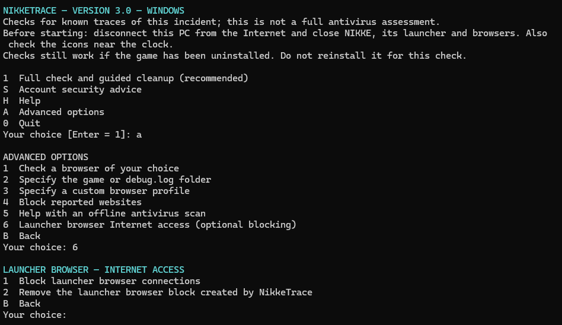

# NikkeTrace

Checks Windows for known traces of the NIKKE launcher incident.

NikkeTrace is a community tool for Windows 10/11 with Windows PowerShell 5.1. The interface defaults to English; French is also available. No Python installation is needed to run the tool.

**Optional launcher browser blocking:** block outbound connections from the browser built into the NIKKE launcher, and undo the block from the same menu. Open **A → 6**. This can prevent sign-in; it does not remove an existing infection.



*Menu example captured before the v3.1 version update. The same controls are available in v3.1.*

## Run

1. Download `nikke-trace-v3.1.zip` from the [latest release](https://github.com/lolerki/nikke-trace/releases/latest).
2. Extract the ZIP, then double-click `NikkeTrace.cmd` on your Windows PC.
3. Press Enter for English, or choose `2` for French.
4. Disconnect the PC from the Internet and close the game, launcher and browsers, including tray icons near the clock.
5. Choose **1 — Full check and guided cleanup**. It runs all nine check groups together, even if the game or launcher has already been removed. Do not reinstall the game to run the check.
6. Read the result and accept or decline the proposed cleanup. The report is saved before you are asked. Press **R** at the confirmation prompt if you want to read it first.
7. Review the optional website-blocking proposal. The three website names are shown before a **separate confirmation**, even if no traces were found or you declined cleanup. Press Enter to decline. If they are already blocked, no change or administrator request is needed.

The normal route explains current traces, historical traces, completed checks, incomplete checks and confirmed actions in plain language. **S — Account security advice** and **H — Help** are available in the main menu and after a check. The advice page only displays instructions; it never changes accounts or passwords. Technical names and paths are available through **D — Details** and **R — Report**. **Option 1** offers website blocking once per guided run, after any cleanup proposal and before exiting for a required restart. Checking again does not repeat this offer. It remains available under **A — Advanced options → Block reported websites** if you want to retry later.

Run it as your usual Windows user. Administrator access is requested only after you approve domain blocking or adding/removing launcher-browser firewall rules. No code is downloaded when the tool runs.

### If Windows blocks the launch

This unsigned launcher can be blocked by Windows 11 **Smart App Control**. Running as administrator or using `ExecutionPolicy Bypass` does not override application-control policy. Do not disable Windows security to run NikkeTrace. A blocked launch means no check has been performed; it is not a finding about your PC.

Compatibility with Smart App Control has not been validated. The current CMD wrapper extracts a PowerShell script, and the cache reader compiles embedded code locally; those components can also be subject to application-control restrictions. Proper signing and testing of the complete launch chain are required before claiming support. See [Microsoft's Smart App Control FAQ](https://support.microsoft.com/en-us/windows/security/threat-malware-protection/smart-app-control-frequently-asked-questions).

### While a check runs

Each group displays its name and elapsed time when it finishes. While a group is waiting, a reminder appears every ten seconds, independently of the check. This reminder confirms that the display is active, not that the underlying Windows operation is making progress. Low CPU usage alone cannot distinguish an idle operation from a blocked one.

The private report records the current group before it starts and the duration of completed groups. If a group remains stuck, press **Ctrl+C** and keep the report for troubleshooting; an interrupted check has no confirmed result. Do not repeatedly restart a suspect launcher. Checks can take longer with large profiles or caches; there is no guaranteed total runtime.

## What it does

- Checks known launcher log and cache markers, browser locations, registry entries, temporary files, and selected local process/network indicators.
- Supports Chrome, Edge, Firefox, Brave, Opera and Vivaldi, with an option to specify a custom profile location.
- Separates current artifacts from historical exposure. Green requires completed checks with no known traces; incomplete checks cannot produce a green negative result. No result certifies that the PC is clean.
- Offers one guided cleanup with consent, integrating recognized artifacts, old NikkeTrace file copies and launcher cache reset. It then checks again and reports confirmed actions, failures and remaining traces.
- Can request normal browser closure after one confirmation, then continues checking without an extra Enter prompt. Save your work before accepting; the browser may still show its own confirmation. It never force-kills browsers.
- Offers to open Windows Installed apps for a normal uninstall. Players finish the operation in Windows, or remove NIKKE through the Google Play Games library for that edition, then choose **Check again**. Opening Settings never counts as a completed uninstall. No installation folder is renamed or deleted by NikkeTrace.
- Provides password and offline antivirus guidance. It does not start an antivirus scan or reboot the PC.

Launcher cache checks cover the standard, HMT and Google Play Games variants. They inspect selected JavaScript caches, local network-state files, known HSTS domain hashes, and LevelDB storage, including Snappy-compressed tables and shared keys. Reads, decompression and traversal have size limits; unreadable, unsupported or malformed files are recorded as incomplete checks.

The launcher's shared CEF sign-in profile is checked for the same indicators. Browser credential databases are not inspected. A domain reference is reported as a historical trace, not as proof that the malware agent executed.

Uncertain files and registry entries are left in place. DLL deletion requires the recognized Chrome path, or the known malicious hash in a checked legacy Chrome location. A helper folder or filename alone does not authorize deletion. The DLL's recorded hash must still match immediately before deletion. Legacy `.dll.old`, `old-clsid.txt` and `service_util.dll` names are reported for review when their contents are unconfirmed. The legitimate Windows HKLM CLSID is not removed.

An early `k2f.lua` file is reported even when its hash is unknown; the filename alone does not authorize deletion or establish that it ran. A `tinyget` file also qualifies for proposed deletion when it meets the official guide's combined criteria: numeric timestamp-style filename, exactly 205,135 bytes, the `Launcher\log\tinyget` location and a verified NIKKE installation. This result is explicitly distinct from a confirmed malicious hash. Its captured hash must still match before deletion. Size alone outside that context never authorizes cleanup.

Temporary-file checks cover three levels of subfolders, including database sidecars, `keyscan` names and PNG screenshots. Uncertain extensions and unrelated `k2f` names are not deletion targets. Common launcher-data locations under LocalAppData are checked read-only in addition to the standard roaming folders.

## Guided cleanup and restart

There is no separate cache menu. Guided cleanup offers the existing NIKKE caches alongside other eligible actions. A normal cache can be reset as a precaution even if no malicious trace was found; its presence alone is not a sign of infection. If saving the report fails, nothing is changed.

When a recognized malicious startup reference must be removed, cleanup pauses after backing it up and removing it. **Save your work, restart Windows, run the same file again and choose the full check.** NikkeTrace checks that Windows has restarted, performs a fresh scan and asks for consent again before continuing with suspicious files and cache. Running it again without restarting cannot bypass this step.

A small checkpoint is stored privately under the current user's local app data. It contains a boot identifier and user SID, not executable commands or an automatic cleanup plan. Nothing is added to Windows startup, and NikkeTrace never restarts the PC itself. A missing boot identifier or invalid checkpoint stops continuation.

Recognized DLLs, known-hash payloads and the targeted temporary files are deleted permanently after confirmation. No quarantine copy of these files is created. The proposed files are listed in the report before consent, and the screen explicitly warns that deletion is permanent. Unchanged DLL/payload contents are checked through the same open file handle used for deletion; files and parent folders cannot be replaced during this operation. Redirected paths and locked files stop the affected operation and are reported as failures. Chrome's legitimate helper files and other files in the same folders are preserved.

Registry backups and the report are retained. Recognized old file copies in NikkeTrace's own quarantine folder are included in the same cleanup proposal. Matching private records, exact generated paths and unchanged contents are required; malformed records or unknown origins are preserved and reported. Non-executable records are kept as an action history. Old renamed game folders and raw-log archives are explicitly reported for manual review and are not recursively deleted.

After you agree, the game and launcher must be closed. Only these folders under the current Windows user's `%APPDATA%` can be deleted:

```text
nikke_launcher\tbs_cache
nikke_launcher_hmt\tbs_cache
nikke_launcher_google\tbs_cache
```

Deletion is permanent. It may sign you out of the launcher and reset its settings; the launcher normally recreates its cache. The report preserves detected indicators, not a backup of the cache contents. Do not restart a suspect launcher just to regenerate the cache.

The shared `%LOCALAPPDATA%\CEF\User Data` folder, additional LocalAppData cache locations, browser profiles and other application folders are excluded from cache deletion. Redirected paths, junctions and symbolic links are rejected. After deletion, the tool checks again and reports remaining traces or incomplete checks; retained read-only-location traces remain visible for review.

## Optional domain blocking

**Option 1 — Full check and guided cleanup** displays these website names and asks separately whether to block them:

```text
insightjs.com
analytics.insightjs.com
insightjs.org
```

The guided screen uses plain language; the exact missing rules, target file and backup path are kept in the private report. **Advanced options → Block reported websites** also shows the exact rules on screen. Accepting cleanup never authorizes website blocking, and declining either action does not prevent the other. No blocking offer or modification is made in non-interactive mode.

The tool reads the existing hosts file first. It recognizes IPv4 and IPv6 blocking entries, including several domains on one line, and adds only missing rules. If all rules are present, it confirms this without writing or asking for administrator access.

Other entries are preserved. A conflicting existing mapping stops the update. Before appending, the tool creates a byte-for-byte backup alongside hosts named `hosts.NIKKE-backup-<id>`. It then reads the file back to verify the result. An error or an unreadable result is never reported as successful blocking.

This blocks only the listed names through the Windows hosts mechanism. Applications can bypass that mechanism, direct IP connections are not blocked, and existing connections may remain open. Domain blocking does not remove malware or secure exposed accounts.

## Optional launcher browser blocking

Open **A — Advanced options → 6 — Launcher browser Internet access**. Choose **1** to block connections, or **2** to remove blocks created by this option. This is separate from the recommended full check and from domain blocking.

Before asking for confirmation, NikkeTrace shows the exact `tbs_browser.exe` paths it will affect. It locates the browser inside verified NIKKE installations, or asks for the installation folder if discovery fails. It creates a Windows Firewall outbound block for each listed program on all network profiles. Administrator approval is requested only after you agree. Chrome, Edge, Firefox, other firewall rules and general firewall settings are preserved.

Blocking can prevent account sign-in and launcher pages from loading. It does not stop the browser process, remove malware or guarantee lower resource use or protection against future attacks. An update that moves the executable can require a new rule. This feature has not yet been validated against a real launcher sign-in; keep it optional during joint testing.

The tool checks its stored rules, the active Windows configuration and firewall profile settings before reporting success. This is a configuration check, not a test of actual network traffic. A missing rule, read error, disabled firewall or policy restricting local rules produces an unconfirmed result. Partial operations may leave rules present; the removal option remains available. Removal works after NIKKE has been uninstalled and never creates an allow rule or removes blocks created by other tools.

## Protect your accounts

Even if no traces are found, use a clean device to change passwords saved or used on the potentially exposed PC, and any passwords reused elsewhere. Start with email and your password manager, then important accounts such as Google/Microsoft, Discord and NIKKE. Revoke existing sessions and enable two-factor authentication. If a password vault was unlocked, also replace the credentials it contained.

## Privacy and limits

The tool has no telemetry or automatic uploads. It does not extract passwords, cookies or authentication tokens. Checks inspect known markers without copying entire sensitive log lines into the report.

Reports and recovery records stay on your PC. Reports are saved under `%LOCALAPPDATA%\NIKKE-Assistance\Reports` and start with a readable summary before the technical details. They can contain your Windows username in file paths: review and redact them before sharing. This repository contains no real user reports, quarantine contents or personal machine configuration.

This is a targeted incident checker, not an antivirus or an official SHIFT UP/Level Infinite product. Other Windows accounts, unknown variants and custom locations you have not provided may not be covered. Removing traces cannot undo earlier credential theft.

## Source and build

`NikkeTrace.ps1` is the readable source. `NikkeTrace.cmd` contains that same source and temporarily extracts it to run with Windows PowerShell. The temporary script is removed on exit; no permanent execution policy change is made.

The cache reader and guarded deletion helper are embedded C# compiled locally by Windows PowerShell. No external library is downloaded. If local policy prevents compilation, the cache check cannot complete and cache deletion is not confirmed.

To rebuild the single-file launcher and player ZIP with Python 3:

```sh
python build.py
```

The ZIP in `dist/` contains only `NikkeTrace.cmd`. Players do not need the source, tests or build script.

The release workflow runs Windows PowerShell tests and verifies the generated launcher before publishing the player ZIP. Updating `releases/v*.md` on `main`, or manually running the workflow on `main`, publishes the version declared in the source. Existing releases are not overwritten.

Run the regression checks on Windows without administrator privileges:

```powershell
powershell.exe -NoProfile -ExecutionPolicy Bypass -File .\tests\Test-Source.ps1
powershell.exe -NoProfile -ExecutionPolicy Bypass -File .\tests\Test-Hosts.ps1
powershell.exe -NoProfile -ExecutionPolicy Bypass -File .\tests\Test-Cache.ps1
powershell.exe -NoProfile -ExecutionPolicy Bypass -File .\tests\Test-Workflow.ps1
powershell.exe -NoProfile -ExecutionPolicy Bypass -File .\tests\Test-Scan.ps1
powershell.exe -NoProfile -ExecutionPolicy Bypass -File .\tests\Test-Completion.ps1
powershell.exe -NoProfile -ExecutionPolicy Bypass -File .\tests\Test-Firewall.ps1
```

Tests use temporary fixtures and mocked operations. They do not edit the system hosts file or firewall, request UAC, launch an antivirus or close real browsers.

Windows 11 local menu launches and fixture tests do not establish Smart App Control compatibility. Real launcher sign-in with the optional browser block and application-control behavior remain unvalidated. Report problems before recommending this optional block broadly; never disable Windows security to run the tool.

## License

MIT — see [LICENSE](LICENSE). The single-file player launcher includes the same notice.
