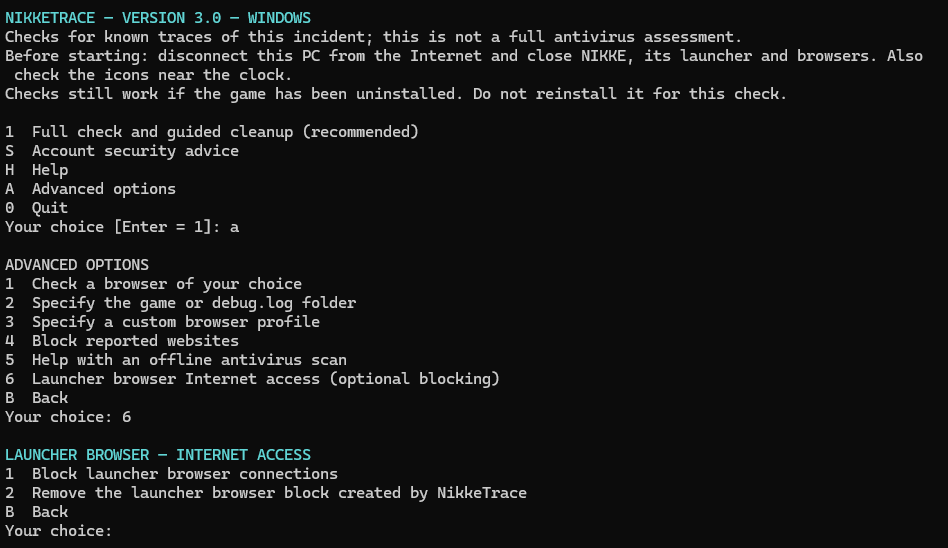

For players: download **nikke-trace-v3.1.zip**, extract it and run **NikkeTrace.cmd**. The ZIP contains one file. English and French are available.

**New: optional blocking of the browser built into the NIKKE launcher.** Open **A → 6**, then choose **1** to block its outbound connections or **2** to remove the blocks created by NikkeTrace. The exact program paths are displayed before a separate confirmation and any administrator request. This can prevent account sign-in and launcher pages from loading; it does not remove an existing infection or guarantee future protection or lower resource use. The option stays separate from the recommended check.

*Screenshot captured before the version update; these menu controls are unchanged in v3.1.*

Other improvements since v3.0:

- Clearer menus and results, visible progress reminders, and one browser-closure confirmation without an extra Enter prompt.
- More targeted checks for legacy files, temporary-file variants and launcher locations, including Google Play Games/HMT. Checks remain useful after uninstalling the game.
- Confirmed, permanent deletion of eligible files after consent, with automatic rechecking. Unknown files, other applications and legitimate browser data are preserved. Recognized old NikkeTrace file copies can also be removed; uncertain copies and old game folders remain for manual review.
- Normal uninstall guidance through Windows Settings replaces renaming the game folder. Opening Settings never counts as a completed uninstall.
- Optional domain blocking is offered once in the recommended route, with the domain list and separate consent. Existing entries are checked first.
- The report is saved before cleanup. Recognized registry cleanup still requires a Windows restart before continuing with files and cache; no automatic restart or startup task is installed.

**Validation:** 234 automated checks on inert fixtures and mocked operations, plus English/French menu launches on Windows. Release automation reruns the tests on a clean Windows runner and verifies that the generated launcher matches the reviewed source. These checks do not validate real launcher sign-in with browser blocking or certify Smart App Control compatibility. Keep Windows security enabled if this unsigned tool is blocked.

**Secure your accounts even if no traces are found:** from a clean device, change passwords saved or used on the potentially exposed PC and reused passwords, revoke sessions and exposed keys/tokens, and enable two-factor authentication. Start with email and your password manager. Cleanup cannot undo possible credential theft. NikkeTrace checks known traces; it is not an antivirus.
